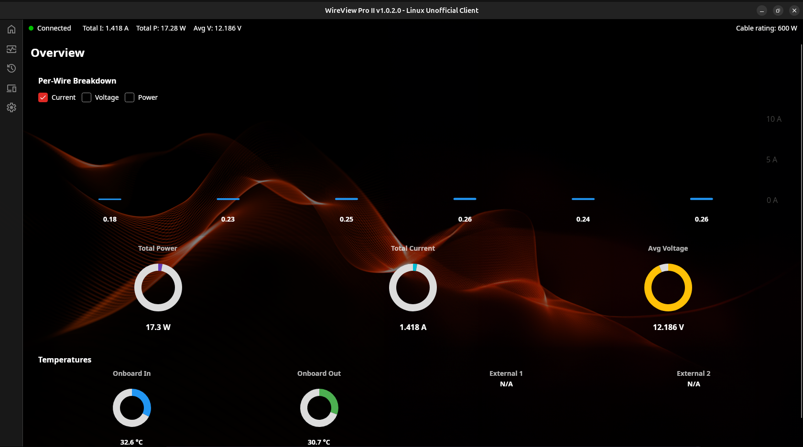

# WireView Pro II - Linux Unofficial Client

Unofficial Linux port of the [Thermal Grizzly WireView Pro II](https://www.thermal-grizzly.com/en/wireview-pro-ii-gpu/s-tg-wv-p2) desktop application. Built with .NET 8.0 and [Avalonia UI](https://avaloniaui.net/).

> A **Windows** build (**WireView Plus**) is also available on the [Releases](https://github.com/emaspa/wireview-linux/releases) page - see [Windows](#windows-x64) under Installation.



## Features

- **Real-time monitoring** - Voltage, current, and power readings across all 6 pins with live charts, plus custom charts: pick any telemetry series, per-series colors, manual or auto Y scaling
- **Device configuration** - Fan speed, display settings, fault alarms, thresholds
- **Configuration profiles** - Save, load, and manage named device configurations
- **Data logging** - On-device log readback and CSV export, browsable per power cycle
- **Desktop notifications** - Via `notify-send`
- **Software shutdown on fault** - Optional system shutdown when a fault alarm triggers, for eGPU or setups where the hardware shutdown header cannot be connected
- **LAN monitoring** - Read WireViews on other machines over the network, optionally publish this host's device, and remotely view/edit a remote device's configuration (HMAC-authenticated). See [LAN monitoring](#lan-monitoring) below
- **Theme editor** - Customize the device display: background images, text and highlight colors, display inversion, with a live preview. Theme files (.wv2t) are compatible with the official Windows app. The Noctua preset is the WireView Pro II Noctua Edition's own look: Thermal Grizzly's Dark background with Noctua colors. It works on any WireView Pro II and is also available as [themes/Noctua-Edition.wv2t](themes/Noctua-Edition.wv2t) for the Windows app
- **Firmware updates** - Flash the bundled firmware (v05, build 20260902_0741) from the Device page over USB DFU. Requires the `dfu-util` package; compares the bundled and device firmware by version and build date, refuses an image made for another product, and warns before downgrades. The bundled image is byte for byte the firmware a Noctua Edition ships with, so flashing it again restores the factory firmware on either edition

> **Warning:** firmware flashing restarts the device into its STM32 bootloader and rewrites its flash. It follows the same DFU procedure as the official Windows client (and refuses to start if `dfu-util` or the firmware image is missing), but a power loss or unplug mid-flash can leave the device unbootable until reflashed manually. This is unofficial software, not affiliated with or endorsed by Thermal Grizzly: flash at your own risk. The previous experimental `dfu-enabled` branch has been removed in favor of this built-in implementation.

> **hwmon integration**: If you want sensor data exposed to `sensors`, Grafana, conky, btop, and other monitoring tools via `/sys/class/hwmon/`, see [wireview-hwmon](https://github.com/emaspa/wireview-hwmon). The kernel module and daemon work standalone without this app, and this app can also use them as an alternative to direct serial communication (see below). That project also includes `wireviewctl`, a CLI tool for monitoring and scripting device commands from the terminal.

## Connection modes

The app supports two ways of communicating with the device:

| Mode | How it works | Features |
|------|-------------|----------|
| **Direct serial** | App talks to the device over `/dev/ttyACM*` | Full control (default) |
| **hwmon + daemon** | App reads sensors from `/sys/class/hwmon/`, sends commands via the [wireviewd](https://github.com/emaspa/wireview-hwmon) daemon socket | Full control, plus sensor data available to system monitoring tools |
| **Through the agent** | App reads and controls the device through [`wireview-agent`](#headless-agent) on this PC, over `127.0.0.1` | Full control; alerts and shutdown on fault keep working with the app closed |

The app auto-detects the connection mode at startup. If the [wireview-hwmon](https://github.com/emaspa/wireview-hwmon) kernel module is loaded, the app uses hwmon for sensor data and connects to the daemon's Unix socket (`/run/wireviewd.sock`) for commands - configuration read/write, fault clearing, screen control, and device info all work through the daemon. If the daemon is not running, the app still displays sensor data in read-only mode.

Commands that change the device through the daemon (configuration writes, NVM store/reset, firmware flashing, and the serial handover used by log reads and the theme editor) need root or membership of the `wireview` group, which the wireview-hwmon packages create: `sudo usermod -aG wireview $USER`. Reading sensors needs no group. Without it the app reports the refused action with that hint, and the automatic theme preview is skipped. Use wireview-hwmon 1.7.0 or later: 1.6.0 refused `wireview` group members when wireviewd ran under systemd, and only 1.7.0 reports the product, so with an older daemon a Noctua Edition is shown as a WireView Pro II.

If the kernel module is not loaded, the app looks for the [headless agent](#headless-agent) on this PC, then falls back to direct serial communication.

## LAN monitoring

Beyond the single local device, the app can monitor and control **WireViews on
other machines** over the LAN - one desktop reading several servers, or two PCs
watching each other.

### Reading remote devices

In **Settings → Remote hosts**, add a comma-separated list of hosts
(`192.168.1.50`, or `host:port` for a custom port - default `9876`). Each remote
device appears in the device picker as `lan @ host` alongside local ones, with
full live monitoring. A remote host is typically the
[wireviewd](https://github.com/emaspa/wireview-hwmon) daemon (Linux/Unraid) or
another copy of this app with publishing enabled (Windows).

### Publishing this host (Windows)

**Settings → Publish this host on the LAN** opens a listener (default port
`9876`, configurable) so other instances can read this machine's device. **Off
by default.** On Linux the `wireviewd` daemon owns publishing, so the toggle is
hidden there. While the [headless agent](#headless-agent) runs, it publishes
instead of the app, and this toggle decides whether it listens on the LAN or on
this PC only.

### Remote control & configuration (authenticated)

Set the same **Network secret** on the publisher and the reader to allow
*writing* to a remote device - screen changes, NVM store/reset, clear-faults,
and the full configuration editor all work against a remote device. Requests are
signed with HMAC-SHA256 (the secret never crosses the wire; replays rejected).
Reading a remote needs no secret; only writes do, and failures are surfaced
precisely (e.g. *"set the network secret"*, *"rejected by the remote host"*,
*"the remote host is unreachable"*).

> Publishing is independent of reading - you can read remote hosts without
> exposing your own. There is no TLS; this targets a trusted LAN.

## Headless agent

`wireview-agent` is a small program with no window that does the always-on
jobs, so the app only needs to run when you want to look at it:

- it owns the device (hwmon through wireviewd when that runs, otherwise the
  serial port, the same choice the app makes),
- it raises the fault notification (Windows toast, `notify-send` on Linux) for
  this PC's device and for every host in **Remote hosts**,
- it shuts the PC down on a fault of this PC's device when **Shutdown on fault**
  is on (a remote host's fault never powers this PC off),
- it publishes the device on port `9876` (the app's publish port): on the LAN
  when **Publish this host on the LAN** is on, on `127.0.0.1` only when it is off.

The agent plus its control panel are a minimal client: everything except the
graphs, firmware updates, themes and the device log, which stay in the app. With
the tray menu and the control panel you can watch the device, switch its screen,
clear faults, edit its configuration and alarms, and set up LAN monitoring and
shutdown on fault without installing or opening the app.

On Linux it needs neither the wireview-hwmon kernel module nor wireviewd: with
no hwmon device it opens the WireView's serial port (`/dev/ttyACM*`) itself, like
the app's direct serial mode. Your user needs access to the port, which the udev
rule in `udev/99-wireview.rules` gives (the packages install it; see the Flatpak
section below for installing it by hand).

It reads the app's own `settings.json`, so the app and the control panel
configure the same settings, and changes apply without restarting the agent. It is meant for Windows and for
Linux without wireviewd (Flatpak, immutable distros); with wireviewd running it
still gives alerts and shutdown, and leaves publishing to the daemon: its own
listener stays on `127.0.0.1` and off the daemon's port, whatever **Publish on
the LAN** says (it logs this once).

```bash
wireview-agent              # run in the foreground (Ctrl+C to stop), logs to stderr
wireview-agent --install    # start it at login
wireview-agent --uninstall  # stop starting it at login
wireview-agent --status     # connected device, fault state and agent version
wireview-agent --open       # print the control panel's address and open it in the browser
wireview-agent --no-tray    # run without the tray icon
wireview-agent --version
wireview-agent --help
```

`--install` writes `~/.config/autostart/wireview-agent.desktop` on Linux and the
`WireView Agent` value under `HKCU\Software\Microsoft\Windows\CurrentVersion\Run`
on Windows (no administrator rights needed). It logs to
`wireview-agent-YYYY-MM-DD.log` in the `logs` folder next to `settings.json`.
`--status` exits with 0 when a device is connected with no active fault, 3 when
the agent is not running, 4 when it runs without a connected device, and 5 on an
active fault. A second copy says it is already running and exits with 1.

**Tray icon.** The agent puts the WireView icon in the notification area. Its
menu, top to bottom:

- the live state (`WireView Pro II: 123.4 W`, the fault while one is active,
  *Serial port lent to the app* during a handover, or *No device*),
- **Open WireView** (starts the app, or on Windows brings the running app's
  window forward),
- **Settings and controls...**, which opens the control panel in the browser,
- **Screen**, a submenu: Main, Simple, Current, Temperature, Status, then
  **Pause updates** and **Resume updates** (the device's display),
- **Clear faults**, enabled while a fault is active (clears the active faults and
  keeps the fault log, like the app's fault banner),
- **Remote hosts**, a submenu shown when the settings list remote hosts, with
  one line per host: `host: 123.4 W`, the host's fault, or `host: offline`,
- the **Publish on the LAN**, **Shutdown on fault** and **Start at login**
  checkboxes (with wireviewd, a disabled *LAN publishing: wireviewd, port 9876*
  line, or *LAN publishing: wireviewd, off*, takes the place of the first),
- **Quit**.

The tooltip carries the same live line. The
two settings checkboxes write `settings.json` and apply at once, like the same
switches in the app; *Start at login* is `--install`/`--uninstall`. If the app is
open at the same time, its next settings save writes back its own copy of those
two switches, so change them in one place while both run. On Linux the icon is a
StatusNotifierItem: KDE, XFCE, Cinnamon and LXQt show it out of the box, GNOME
needs the AppIndicator/KStatusNotifierItem extension. On a desktop without a tray
(or with no session bus) the agent logs one line, keeps running without the
icon and adds it when a tray shows up later. `--no-tray` turns it off.

**Control panel.** A single page served by the agent on its own port, opened in
the default browser by the tray's **Settings and controls...** or by
`wireview-agent --open` (which also prints the address, for desktops without a
tray). It works offline and answers this PC only: from any other address it
returns 403, even while the port is open on the LAN. Each run of the agent makes
a new random access token; the tray and `--open` put it in the address (after
`#t=`), and the page sends it with every request, so other web pages and other
users cannot use it. When the publish port is taken (on Linux wireviewd holds
`9876`), the agent serves the panel, `/sensors` and the app's connection on a
loopback-only fallback port instead (the next free one of the publish port +1
to +10, else any free port), logs `control panel on http://127.0.0.1:<port>`,
and moves back to the publish port once it is free (it retries every 30 s); the
tray, `--open` and `--status` use whichever port it is on. The page shows,
refreshed every second:

- **Status**: device, firmware, source (`hwmon` or `serial:/dev/ttyACM0`, `COM3`),
  total power, current and voltage, each pin's voltage, current and power, the
  temperatures, the fan duty, and the fault state with a **Clear faults** button,
- **Remote hosts**: the same readings for each host in the settings, read only,
- **Screen**: the five screens, pause and resume,
- **Device configuration**, grouped like the app's Device page: General (friendly
  name, backlight), Fan (mode, temperature source, duty and temperature limits),
  Display (current and power scale, theme on older firmware, rotation, timeout
  mode, cycle screens, cycle time, timeout, averaging, default screen), the
  fault alarm table (display, buzzer, soft off, hard off per fault type) and the
  fault thresholds. **Apply** writes only the fields you changed, the way the
  app does; **Store to device memory** keeps them after a power cycle; **Reload
  from device**, **Reload from device memory** and **Reset to defaults** (asks
  first) are there too. Out-of-range values are refused with a message,
- **Alerts and shutdown**: Shutdown on fault, Start at login (fault
  notifications are always on),
- **LAN monitoring**: Publish on the LAN, the port (the page follows the agent to
  a new port), the remote hosts to watch, and the network secret; with
  wireviewd, the daemon's own settings instead of the first two (below),
- **Tools**: Open WireView app (graphs, firmware updates, themes, device log) and
  where the agent's log is.

Settings changed on the page are saved to `settings.json` and applied at once,
the same path as the tray's switches (and, as with those, an app that is open
at the same time writes back its own copy on its next settings save). Device writes go to the device the same
way as a command from the LAN, so they work over hwmon with wireviewd and over
direct serial alike. `GET /sensors` on the same port is unchanged.

**wireviewd's settings.** When the device is reached through hwmon with
wireviewd, the daemon does the LAN publishing, so the **LAN monitoring** card
says so with what answers on the daemon's port (*answering on port 9876* or
*off*) and edits the daemon's settings in `/etc/wireview/config` in place of
the agent's own switch and port: **Publish on the LAN** (`remote_enabled`),
**Port**, **Bind address** (empty for all addresses), **Secret** (the passphrase
other hosts sign their writes to this PC with) and **Log retention** (days, 0
keeps every log). **Save** writes only the changed keys through
`wireviewctl config set` (the secret on its standard input, never on a command
line) and wireviewd reloads them without a restart; the result line shows the
daemon's answer, such as `config reloaded: listener on [::]:9876`, or
wireviewctl's message when a value is refused or the file is not writable.
**Use the same secret for remote hosts**, under the agent's network secret,
copies the daemon's secret there on Save, so this PC signs its writes to the
other hosts with the same one. This needs wireview-hwmon 1.8 or newer (older
versions have no `wireviewctl config`, and the card says so) and membership of
the `wireview` group (`sudo usermod -aG wireview $USER`, then log in again).
The agent moves its own loopback listener off a port you give the daemon, and
the page follows it. `WIREVIEW_CTL` overrides which `wireviewctl` is run.

On Windows the agent has no console window, so starting it at login shows
nothing. Its options still print in a terminal; to wait for the output and get
the exit code, use `start /wait wireview-agent --status` in cmd, or
`wireview-agent --status | Out-Host` in PowerShell.

**How the app uses it.** At startup the app asks `http://127.0.0.1:9876/sensors`
before it opens the serial port (after hwmon on Linux). When the agent answers,
the app connects through it, shown as `agent` in the device picker and
*Connected via agent* in the status bar, and does not open the port itself:
two programs on one serial port corrupt each other's data. The app signs its
commands to the agent with a key the agent keeps next to `settings.json`
(`agent.key`), so writes work with no network secret set. The app does not show
a second fault notification while the agent runs.

**Serial handover.** Firmware flashing, reading the device log and the theme
editor need the serial port itself. For those the app asks the agent to let go
of the port, does the transfer and hands the port back, like the handover with
wireviewd. Meanwhile the agent keeps publishing the last reading, marked not
connected. If the app never hands the port back (it crashed), the agent takes it
back on its own after at most 10 minutes. The handover is accepted only from
this PC.

Build it from source with:

```bash
dotnet publish WireViewAgent -c Release -r linux-x64 --self-contained -p:PublishSingleFile=true
dotnet publish WireViewAgent -c Release -r win-x64 --self-contained -p:PublishSingleFile=true
```

## Requirements

- Linux with USB support (tested on Ubuntu 24.04 / 26.04 LTS, Fedora 43-44, and Arch Linux; also packaged for Arch-based distros via the AUR and immutable distros like Bazzite / Silverblue via Flatpak)
- A Thermal Grizzly WireView Pro II or WireView Pro II Noctua Edition connected via USB (the Noctua Edition is tested on a real unit)
- For the hwmon + daemon mode: [wireview-hwmon](https://github.com/emaspa/wireview-hwmon) 1.7.0 or later
- Optional: `dfu-util` for in-app firmware flashing (the Flatpak bundles it; deb/rpm/AUR packages list it as a recommended/optional dependency)

## Installation

### Windows (x64)

A self-contained Windows build, **WireView Plus**, is published on the [Releases](https://github.com/emaspa/wireview-linux/releases) page (`wireview-plus-<version>-windows-x64.zip`). Extract it and run the executable - no installation or .NET runtime required.

### Ubuntu 24.04 / 26.04 LTS (PPA)

```bash
sudo add-apt-repository ppa:sparvoli/wireview-hwmon
sudo apt update
sudo apt install wireview-linux
```

To also install the hwmon kernel module and daemon for system-wide sensor integration:

```bash
sudo apt install wireview-hwmon wireview-hwmon-dkms
```

### Ubuntu / Debian (.deb package)

A pre-built `.deb` package is available on the [Releases](https://github.com/emaspa/wireview-linux/releases) page. Download it and install:

```bash
sudo apt install ./wireview-linux_*_amd64.deb
```

### Fedora (COPR)

```bash
sudo dnf copr enable emaspa/wireview-linux
sudo dnf install wireview-linux
```

Or grab the standalone `.rpm` from the [Releases](https://github.com/emaspa/wireview-linux/releases) page - a single RPM works on all current Fedora releases (tested on 42, 43, and 44):

```bash
sudo dnf install ./wireview-linux-*.x86_64.rpm
```

To also install the hwmon kernel module and daemon for system-wide sensor integration (same COPR repo):

```bash
sudo dnf install wireview-hwmon wireview-hwmon-dkms
```

The package is a self-contained binary - no .NET runtime is required. For immutable, atomic distros (Bazzite, Silverblue, Kinoite), use the Flatpak below instead.

### Flatpak (Bazzite / Silverblue / immutable distros)

A `.flatpak` bundle is available on the [Releases](https://github.com/emaspa/wireview-linux/releases) page:

```bash
flatpak install ./wireview-linux-*.flatpak
flatpak run io.github.emaspa.WireViewLinux
```

The Flatpak supports direct USB serial mode. A sandbox cannot install udev rules, so install the rule on the host once:

```bash
sudo curl -fsSL https://raw.githubusercontent.com/emaspa/wireview-linux/main/udev/99-wireview.rules \
  -o /etc/udev/rules.d/99-wireview.rules
sudo udevadm control --reload-rules && sudo udevadm trigger
```

### Arch Linux / CachyOS / EndeavourOS (AUR)

[`wireview-linux-bin`](https://aur.archlinux.org/packages/wireview-linux-bin) installs the pre-built release binary (no .NET SDK, no compile) and tracks the latest release:

```bash
yay -S wireview-linux-bin
```

[`wireview-linux`](https://aur.archlinux.org/packages/wireview-linux), started by [Arakmar](https://github.com/Arakmar) and now co-maintained here, builds the same release from source with the Arch .NET SDK. It is updated together with the binary package, so pick whichever you prefer:

```bash
yay -S wireview-linux        # builds from source, takes a few minutes
```

To also install the hwmon kernel module and daemon for system-wide sensor integration, load the module and enable the daemon after installing:

```bash
yay -S wireview-hwmon wireview-hwmon-dkms
sudo modprobe wireview_hwmon
sudo systemctl enable --now wireviewd
```

From the next boot onward both come up automatically (the dkms package registers the module in `modules-load.d` and the service modprobes it on start).

### NixOS (flake)

The repository is a flake. Its NixOS module installs the app, built from source, and the udev rule. Add [wireview-hwmon](https://github.com/emaspa/wireview-hwmon)'s module for the hwmon + daemon mode:

```nix
{
  inputs = {
    wireview-linux.url = "github:emaspa/wireview-linux";
    wireview-hwmon.url = "github:emaspa/wireview-hwmon";
  };

  outputs = { nixpkgs, wireview-linux, wireview-hwmon, ... }: {
    nixosConfigurations.myhost = nixpkgs.lib.nixosSystem {
      system = "x86_64-linux";
      modules = [
        ./configuration.nix
        wireview-linux.nixosModules.default
        wireview-hwmon.nixosModules.default
        {
          programs.wireview-linux.enable = true;
          services.wireview-hwmon.enable = true;
          users.users.alice.extraGroups = [ "wireview" ];
        }
      ];
    };
  };
}
```

`nix run github:emaspa/wireview-linux` starts the app without installing it, but direct serial access still needs the udev rule from the module. The package is marked unfree because it contains decompiled upstream code and Thermal Grizzly's firmware. The flake allows it on its own, so no `allowUnfree` setting is needed.

### Serial access (package installs)

The package installs above (PPA, `.deb`, `.rpm`, AUR) install the udev rule and
the system reloads it automatically, so **serial access works out of the box**
for the user logged in at the local seat - the rule makes the serial port
`0660` in the distro's serial group (`dialout`, or `uucp` on Arch-based
distros), the DFU bootloader `0660 root:dialout`, and gives the active session
a logind `uaccess` ACL, so no group membership or logout is needed there. The
rule installs unchanged on any distro. Arch-based distros have no `dialout`
group, so the AUR package gives the DFU bootloader their serial group `uucp`
instead.

If access still fails in an unusual setup (for example over SSH, where the
`uaccess` ACL doesn't apply), add yourself to the serial group and log back
in:

```bash
# Debian, Ubuntu, Fedora and most other distros
sudo usermod -aG dialout "$USER"

# Arch-based distros
sudo usermod -aG uucp "$USER"
```

### Option 1: Pre-built binary (no .NET required)

The tarball is self-contained: the app binary, the udev rule, and a one-time
`install.sh` that sets up USB serial access.

```bash
# Download and extract the latest release
curl -sL $(curl -s https://api.github.com/repos/emaspa/wireview-linux/releases/latest | grep -o 'https://.*linux-x64.tar.gz') | tar xz
cd wireview-linux-*-linux-x64

# One-time USB serial setup (installs the udev rule)
./install.sh

# Run
./WireView2
```

### Option 2: Build from source

Requires [.NET 8.0 SDK](https://dotnet.microsoft.com/download/dotnet/8.0) or later.

```bash
git clone https://github.com/emaspa/wireview-linux.git
cd wireview-linux
./install.sh
```

Run it as your own user; it uses `sudo` where it needs root. The install script will:
1. Install the udev rule (serial port and DFU bootloader `0660` in the serial group,
   plus a `uaccess` ACL for the user logged in at the local seat). The serial group
   is `dialout`, or `uucp` on Arch-based distros
2. Only when there is no local seat session (SSH, for example): add your user to that
   group, which needs a new login to take effect
3. Build the application

Or manually step by step:

```bash
git clone https://github.com/emaspa/wireview-linux.git
cd wireview-linux

# Install udev rules (grants access to the WireView USB device)
sudo cp udev/99-wireview.rules /etc/udev/rules.d/
# Arch-based distros have no dialout group, their serial group is uucp
getent group dialout >/dev/null || sudo sed -i 's/GROUP="dialout"/GROUP="uucp"/g' /etc/udev/rules.d/99-wireview.rules
sudo udevadm control --reload-rules
sudo udevadm trigger

# Only over SSH or another session without a local seat (no uaccess ACL there):
# join the serial group, then log in again
# sudo usermod -aG dialout $USER
# Arch-based distros: sudo usermod -aG uucp $USER

# Build and run
dotnet build -c Release
dotnet run --project WireView2/ -c Release
```

### Quick permissions fix (no reboot)

If you just want to test without logging out:

```bash
sudo chmod 666 /dev/ttyACM0
```

This is temporary and resets when the device is unplugged.

## Usage

The app has five pages accessible from the left sidebar:

| Page | Description |
|------|-------------|
| **Overview** | Summary of total current, power, voltage, cable rating, temperatures (sensors that are not connected are hidden), and a fault status/log table with per-fault clear |
| **Monitoring** | Real-time charts for voltage, current, power, and temperature; custom series selection, colors, and Y scaling |
| **Logging** | Read device logs per power cycle and export to CSV |
| **Device** | Device info, full device configuration (fan, display, alarms, thresholds), display theme editor, and firmware updates |
| **Settings** | App theme (Auto, Light, Dark, Noctua Light, Noctua Dark; Auto follows the desktop's light/dark setting and switches to the Noctua colors while a WireView Pro II Noctua Edition is selected), startup behavior, background, and LAN settings (remote hosts, publish toggle/port, network secret, log retention) |

`wireview-linux --page monitoring` opens on a given page (overview, monitoring,
logging, device, settings) instead of Overview.

### Configuration profiles

On the **Device** page, you can save the current device configuration as a named profile and load it later. Profiles are stored as JSON files in `~/.local/share/PowerMonitor/profiles/`.

## USB device IDs

| Mode | VID | PID | Description |
|------|-----|-----|-------------|
| Normal | `0483` | `5740` | STM32 CDC/ACM virtual serial port |
| DFU bootloader | `0483` | `df11` | STM32 bootloader (during firmware updates) |

## Project structure

```
wireview-linux/
├── WireView2/                  # Main Avalonia UI application
│   ├── Views/                  # AXAML views
│   ├── ViewModels/             # MVVM view models
│   ├── Services/               # App settings, profiles, notifications
│   └── Assets/                 # Icons, backgrounds
├── WireViewDeviceLib/          # Device communication library
│   └── Device/                 # Serial + hwmon + network devices, port finder
├── WireViewNet/                # LAN layer - /sensors publisher, remote device client, HMAC auth
├── udev/                       # udev rules for USB permissions
└── install.sh                  # Installation script
```

## Tech stack

- **.NET 8.0** - Runtime and build system
- **Avalonia UI 12.0** - Cross-platform MVVM UI framework
- **CommunityToolkit.Mvvm 8.4** - MVVM source generators
- **Custom chart controls** - Lightweight line/gauge/bar charts drawn directly with Avalonia (no charting dependency)
- **System.IO.Ports** - Serial communication with the device

## Troubleshooting

### Device not detected

1. Check that the device is connected: `lsusb | grep 0483`
2. Check that `/dev/ttyACM0` exists: `ls -la /dev/ttyACM*`
3. Check permissions: in a local desktop session `getfacl /dev/ttyACM0` should list your
   user (the `uaccess` ACL); over SSH, `groups` should include `dialout` (`uucp` on
   Arch-based distros)
4. If using a VM, ensure USB passthrough is configured for the VID/PID pair

### Rendering backend

On Linux the app draws with Avalonia's software renderer by default. It keeps
Mesa out of the process (about 120 MB less resident memory, 55 MB less
proportional), and it avoids the GL-under-XWayland glitches some Nvidia setups
showed. It costs CPU only on the Monitoring page at fast polling (at 50 ms,
about 10 % of one core instead of 4 % on a 1200x800 window; larger windows cost
proportionally more). **Settings → Startup → GPU rendering** switches to the
GPU backend at the next start. `WIREVIEW_RENDER_MODE` overrides the setting
with a comma-separated preference list:

```bash
WIREVIEW_RENDER_MODE=egl,software wireview-linux   # Linux: software, egl, glx, vulkan
set WIREVIEW_RENDER_MODE=software                   # Windows: software, angle, wgl, vulkan
```

Windows defaults to GPU rendering (ANGLE on Direct3D); the same setting turns
it off.

### Permission denied on /dev/ttyACM0

```bash
# Temporary fix (until the device is replugged):
sudo setfacl -m "u:$USER:rw" /dev/ttyACM0

# Permanent fix:
sudo cp udev/99-wireview.rules /etc/udev/rules.d/
# Arch-based distros have no dialout group, their serial group is uucp
getent group dialout >/dev/null || sudo sed -i 's/GROUP="dialout"/GROUP="uucp"/g' /etc/udev/rules.d/99-wireview.rules
sudo udevadm control --reload-rules
sudo udevadm trigger
# Over SSH or without a local seat session, also join the serial group and
# log in again:
sudo usermod -aG dialout $USER
# Arch-based distros: sudo usermod -aG uucp $USER
```

## Thanks

Thanks to [Thermal Grizzly](https://www.thermal-grizzly.com/) for providing a WireView Pro II Noctua Edition unit for development.

## Disclaimer

This software is an unofficial, community-made Linux port of the WireView Pro II application. It is **not affiliated with, endorsed by, or supported by Thermal Grizzly or ElmorLabs**. All trademarks belong to their respective owners.

Use at your own risk. This software interacts with hardware, while every effort has been made to ensure correctness, the authors are not responsible for any damage to your device.

## License

This project contains code decompiled from the original WireView Pro II Windows application and code from the [WireViewDeviceLib](https://github.com/ElmorLabs-ThermalGrizzly/WireViewDeviceLib) repository. Please respect the original authors' rights. This port is provided for personal use and interoperability purposes.
