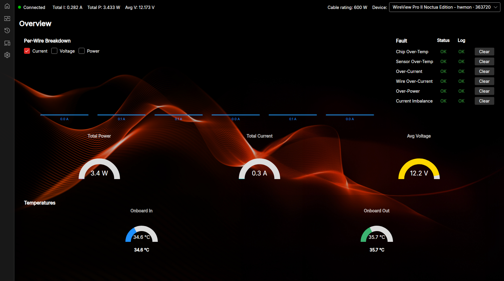

# WireView Pro II - Linux Unofficial Client

Unofficial Linux port of the [Thermal Grizzly WireView Pro II](https://www.thermal-grizzly.com/en/wireview-pro-ii-gpu/s-tg-wv-p2) desktop application, plus **WireView Mini**, a small always-on companion with a tray icon and a browser control panel. On Windows, WireView Mini is the client; the desktop app is Linux only. Built with .NET 8.0 and [Avalonia UI](https://avaloniaui.net/). Not affiliated with, endorsed by, or supported by Thermal Grizzly or ElmorLabs. For sensors in `/sys/class/hwmon/` (`sensors`, Grafana, conky, btop) and the `wireviewctl` CLI, see [wireview-hwmon](https://github.com/emaspa/wireview-hwmon).



The app follows the connected device's look ([Noctua Edition](docs/screenshot-app-noctua.png)). WireView Mini's control panel: [first screen](docs/screenshot-mini.png), [every card open](docs/screenshot-mini-full.png).

## Features

- **Real-time monitoring**: voltage, current and power on all 6 pins, live charts and custom charts (any series, per-series colors, manual or auto Y scaling)
- **Device configuration**: fan, display, fault alarms and thresholds, saved and loaded as named profiles
- **Data logging**: on-device log readback per power cycle, CSV export
- **Alerts**: desktop notifications via `notify-send`, and optional software shutdown on fault for eGPUs or setups without the hardware shutdown header
- **LAN monitoring**: read WireViews on other machines and edit their configuration (HMAC-authenticated). See [LAN monitoring](docs/lan-monitoring.md)
- **Theme editor**: background images, colors, inversion and a live preview; `.wv2t` files work with the official Windows app. See [usage](docs/usage.md#theme-editor)
- **Firmware updates**: flash the bundled firmware (v05, build 20260902_0741) over USB DFU with `dfu-util`. See [firmware](docs/firmware.md)
- **WireView Mini**: alerts, shutdown on fault and the device on the LAN with the app closed. See [WireView Mini](docs/wireview-mini.md)
- **hwmon integration**: works with the [wireview-hwmon](https://github.com/emaspa/wireview-hwmon) kernel module and daemon as an alternative to direct serial

**Firmware flashing can leave the device unbootable if it is interrupted. Flash at your own risk and read the [full warning](docs/firmware.md#warning) first.**

## Two apps

| | Desktop app (`WireView2`, Linux) | WireView Mini (`wireview-mini`, Linux and Windows) |
|---|---|---|
| What it is | The full window: Overview, Monitoring, Logging, Device and Settings pages | A program with no window: a tray icon and a control panel in the browser |
| When it runs | When you want to look at the device | All the time, started at login |
| What it does | Monitoring, charts, device log, configuration and profiles, theme editor, firmware updates, LAN monitoring | Monitoring, fault alerts, shutdown on fault, device configuration and profiles, firmware updates, theme editor, charts, device log, CSV export, LAN publishing |

Both read the same `settings.json`. While WireView Mini runs, the app connects through it instead of opening the serial port. Details: [docs/wireview-mini.md](docs/wireview-mini.md).

### Footprint

Why there are two clients, and which to leave running. Device connected, one reading a second, after a few minutes. Memory is what the process has resident, the same measure on both systems (resident set on Linux, working set on Windows); the method, the proportional-set figures and the history are in [docs/footprint-plan.md](docs/footprint-plan.md).

| Process | Memory | Idle CPU, one core | Notes |
|---|---|---|---|
| Official Windows app 1.0.8, window visible | 341 MB | 2.1 % | Windows 11 with a GeForce RTX 5090, GPU rendering |
| Official Windows app 1.0.8, minimized after use | 166 MB | 0.5 % | Started minimized and never opened it stays at 92 MB and 0.03 %, but the first look at the window costs the memory above |
| Desktop app, window visible | 150 MB | 2.3 % (software rendering), 1.1 to 2.7 % (GPU) | Linux, with wireview-hwmon alongside. Overview page; the Monitoring page at 50 ms polling costs 4 to 10 % |
| Desktop app, minimized | 126 MB | 0.6 % | Linux, as above |
| WireView Mini on Linux | 50 MB | 0.1 to 0.2 % | Tray icon and one hour of chart history included; the control panel adds nothing while closed, and the browser does the drawing while open |
| WireView Mini on Windows | 37 MB | 0 to 0.2 % | Same; Task Manager shows 24 MB, as its Memory column leaves out the shared pages |
| wireviewd (the daemon) | 2.3 MB | 0 % | C, no GUI; publishes the device on the LAN and serves `/sys/class/hwmon/` |

In short: the app is for looking at the device and WireView Mini for watching it. The daemon is the base under both on Linux: it gives the device to the whole system as hwmon sensors and on the LAN, serves the app and WireView Mini, and runs alone on a machine with no desktop.

## Install

| Channel | Commands |
|---|---|
| Windows (x64) | WireView Mini only: download `wireview-mini-<version>-windows-x64.zip` from [Releases](https://github.com/emaspa/wireview-linux/releases), extract it and run `wireview-mini.exe` (`wireview-mini --install` starts it at login). The official application remains the desktop app there |
| Ubuntu 24.04 / 26.04 LTS (PPA) | `sudo add-apt-repository ppa:sparvoli/wireview-hwmon`<br>`sudo apt install wireview-linux` |
| Ubuntu / Debian (.deb) | `sudo apt install ./wireview-linux_*_amd64.deb` (from [Releases](https://github.com/emaspa/wireview-linux/releases)) |
| Fedora (COPR) | `sudo dnf copr enable emaspa/wireview-linux`<br>`sudo dnf install wireview-linux` |
| Flatpak (Bazzite, Silverblue) | `flatpak install ./wireview-linux-*.flatpak` (from [Releases](https://github.com/emaspa/wireview-linux/releases)), then the [host udev rule](docs/install.md#flatpak). The app only, no WireView Mini |
| Arch / CachyOS / EndeavourOS (AUR) | `yay -S wireview-linux-bin` (or `yay -S wireview-linux` to build from source) |
| NixOS (flake) | `nix run github:emaspa/wireview-linux`, or the [NixOS module](docs/install.md#nixos-flake). The app only, no WireView Mini yet |
| Pre-built tarball | Extract the `linux-x64.tar.gz` release, then `./install.sh` and `./WireView2` (`./wireview-mini` for WireView Mini) |
| Build from source | `git clone https://github.com/emaspa/wireview-linux.git`<br>`cd wireview-linux && ./install.sh` |

The PPA, .deb, COPR/.rpm and AUR packages install WireView Mini as `wireview-mini` next to the app (`wireview-mini --install` starts it at login), and the tarball carries it beside `WireView2`. The packages install the udev rule, so serial access works out of the box for the user at the local seat. The long version (requirements, serial access and groups, the hwmon packages, NixOS, Flatpak, building, troubleshooting) is in [docs/install.md](docs/install.md).

## Connection modes

| Mode | How it works | Features |
|------|-------------|----------|
| **Direct serial** | App talks to the device over `/dev/ttyACM*` | Full control (default) |
| **hwmon + daemon** | App reads sensors from `/sys/class/hwmon/`, sends commands via the [wireviewd](https://github.com/emaspa/wireview-hwmon) daemon socket | Full control, plus sensor data available to system monitoring tools |
| **Through WireView Mini** | App reads and controls the device through [`wireview-mini`](docs/wireview-mini.md) on this PC, over `127.0.0.1` | Full control; alerts and shutdown on fault keep working with the app closed |

The app picks the mode at startup: hwmon when the wireview-hwmon module is loaded, then WireView Mini, then direct serial. Writes through the daemon need the `wireview` group and wireview-hwmon 1.7.0 or later. Details: [docs/usage.md](docs/usage.md#connection-modes).

## Quick usage

```bash
wireview-linux                    # start the app (./WireView2 from the tarball)
wireview-linux --page monitoring  # open on overview, monitoring, logging, device or settings
flatpak run io.github.emaspa.WireViewLinux   # the Flatpak

wireview-mini              # run WireView Mini in the foreground (Ctrl+C to stop)
wireview-mini --install    # start it at login
wireview-mini --open       # open its control panel in the browser
wireview-mini --status     # connected device, fault state and version
```

Settings live in `~/.config/PowerMonitor/settings.json` on Linux, shared by the app and WireView Mini, and in `%APPDATA%\PowerMonitor\settings.json` on Windows, where WireView Mini shares the official application's file.

## Documentation

- [Installation](docs/install.md): every channel, serial access, udev, building from source, troubleshooting
- [Using the app](docs/usage.md): connection modes, pages, profiles, theme editor, logging, rendering, USB IDs, project structure
- [WireView Mini](docs/wireview-mini.md): tray, control panel, serial handover, ports, building, settings
- [LAN monitoring](docs/lan-monitoring.md): remote hosts, publishing, the network secret
- [Firmware updates](docs/firmware.md): the warning, checks, `dfu-util`, udev, Windows
- Design notes: [footprint plan](docs/footprint-plan.md), [upstream 1.0.7 port plan](docs/upstream-1.0.7-port-plan.md), [upstream 1.0.8 port plan](docs/upstream-1.0.8-port-plan.md)

## License and credits

Thanks to [Thermal Grizzly](https://www.thermal-grizzly.com/) for providing a WireView Pro II Noctua Edition unit for development.

This software is an unofficial, community-made Linux port of the WireView Pro II application. It is **not affiliated with, endorsed by, or supported by Thermal Grizzly or ElmorLabs**. All trademarks belong to their respective owners.

Use at your own risk. This software interacts with hardware, while every effort has been made to ensure correctness, the authors are not responsible for any damage to your device.

This project contains code decompiled from the original WireView Pro II Windows application and code from the [WireViewDeviceLib](https://github.com/ElmorLabs-ThermalGrizzly/WireViewDeviceLib) repository. Please respect the original authors' rights. This port is provided for personal use and interoperability purposes.
